# owrt-bot

Telegram-бот, который работает прямо на роутере с OpenWrt. Через него можно
будить компьютеры по Wake-on-LAN и видеть, включились ли они, смотреть
нагрузку и трафик роутера, блокировать устройства в сети и обновлять пакеты.
Настройки бота есть в LuCI.

Бот написан на Go и ставится одним файлом без зависимостей, в памяти занимает
около 12 МБ. С Telegram он держит одно постоянное соединение, поэтому кнопка
отвечает примерно за 0,3 с. Предыдущая версия на Lua (`owrt-tg-bot`) запускала
`curl` на каждый запрос, и через VPN-туннель одно нажатие занимало 1,3–2 с.

<table>
<tr>
<td>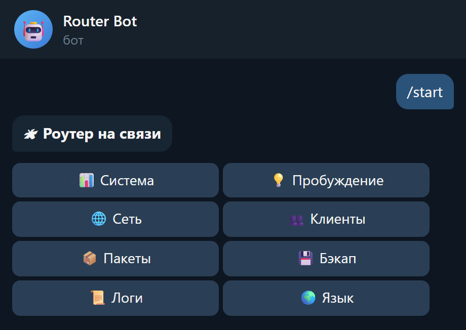</td>
<td>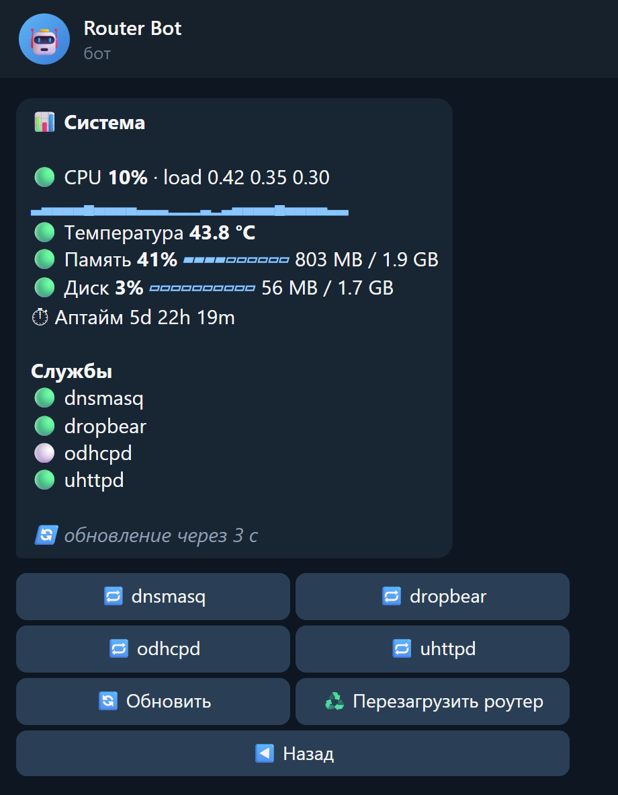</td>
<td>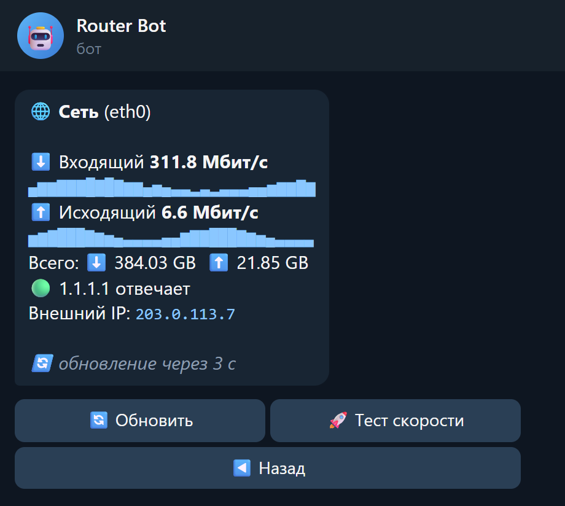</td>
</tr>
<tr>
<td>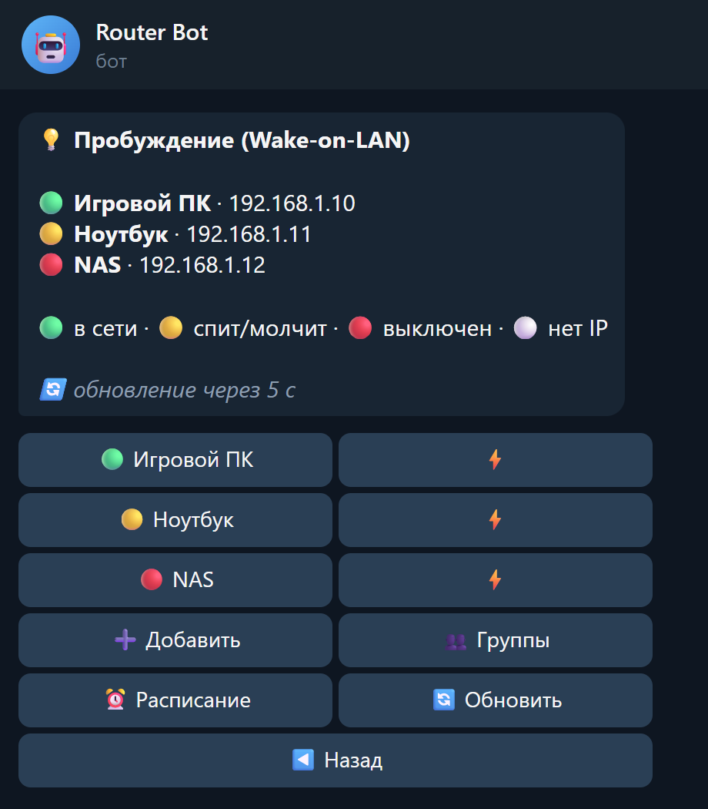</td>
<td>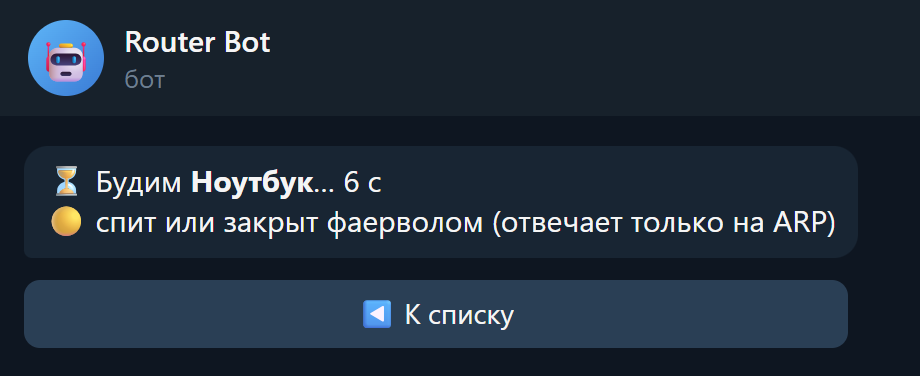<br>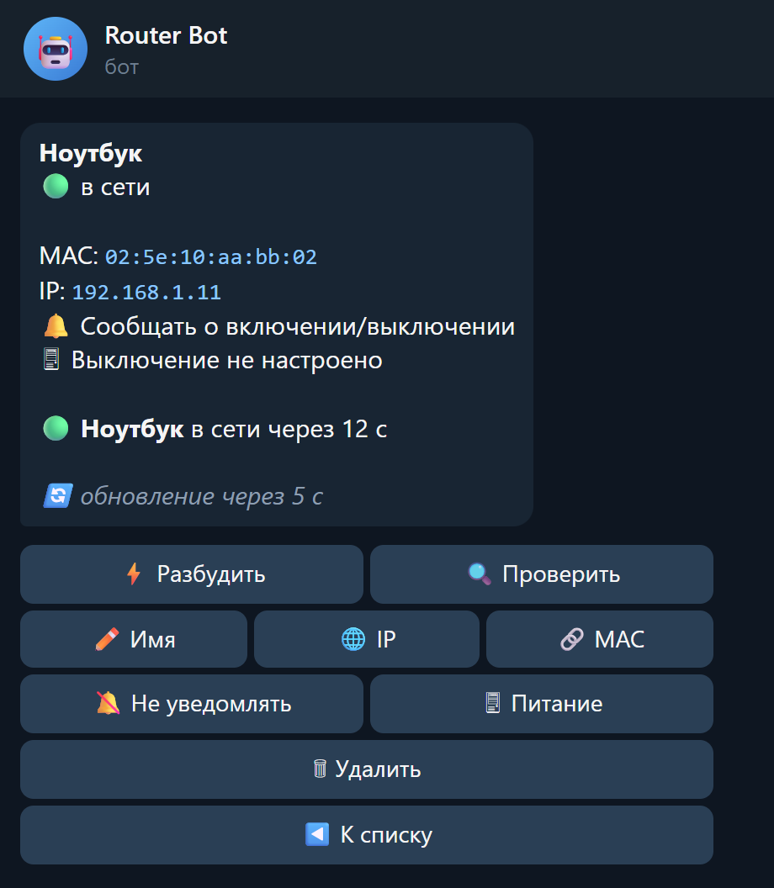</td>
<td>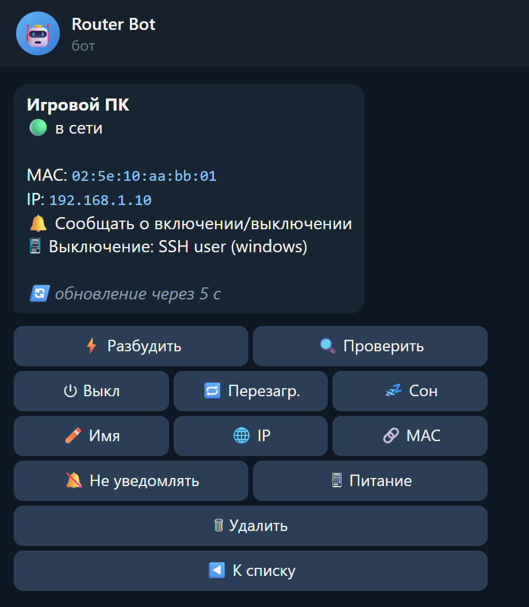</td>
</tr>
<tr>
<td>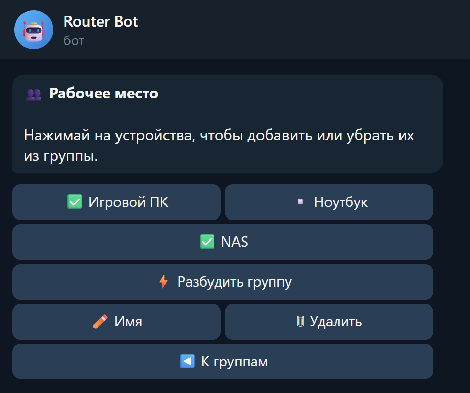</td>
<td>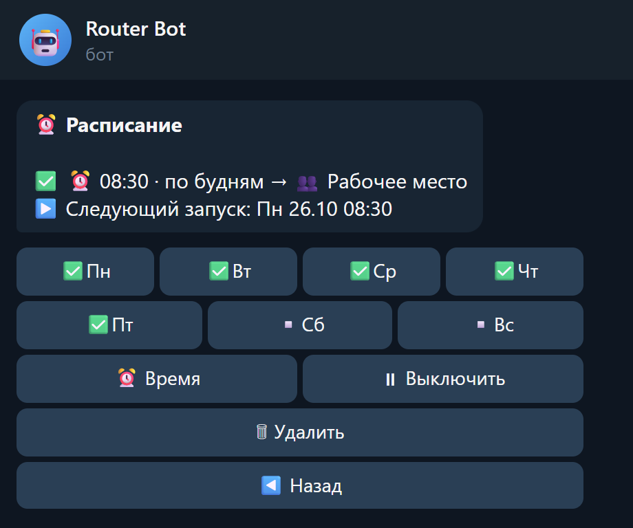</td>
<td>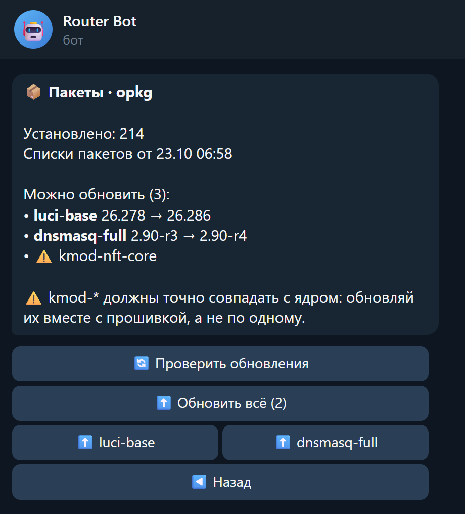</td>
</tr>
</table>

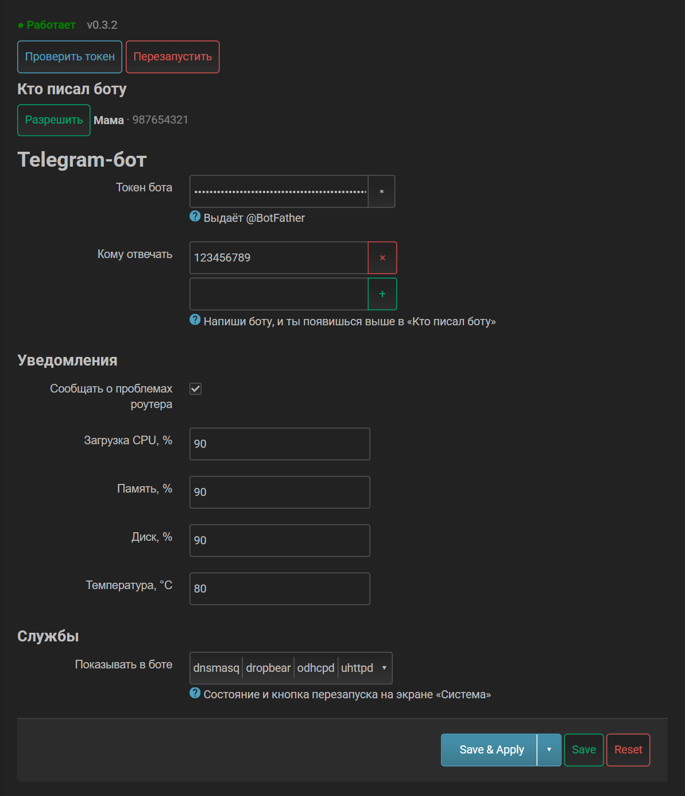

<sub>Экраны Telegram сняты с вывода бота на демо-данных (`tools/screens`), рамка
клиента нарисована. Страница LuCI снята с роутера.</sub>

## Установка

На роутере под root:

```sh
curl -fsSL https://raw.githubusercontent.com/lastharbor/owrt-bot/main/install.sh | sh
```

Скрипт определяет архитектуру, скачивает бинарник из
[релизов](https://github.com/lastharbor/owrt-bot/releases) и сверяет sha256.
Потом спрашивает токен бота от @BotFather и проверяет его. Чтобы узнать твой
chat id, он ждёт до двух минут, пока ты напишешь боту любое сообщение. Если
на роутере стоял `owrt-tg-bot`, скрипт переносит его настройки и выключает его.

Если на роутере нет `curl`: `uclient-fetch -qO- <url> | sh`.

Поставить без вопросов:

```sh
curl -fsSL https://raw.githubusercontent.com/lastharbor/owrt-bot/main/install.sh | BOT_TOKEN=123:abc CHAT_ID=111111 sh
```

Та же команда обновляет бота, настройки и устройства сохраняются. Конкретная
версия: `OWRT_BOT_VERSION=v0.3.3`. Удалить бота: `| sh -s -- uninstall`, вместе
с настройками: `| sh -s -- purge`.

Сборки есть для `aarch64`, `x86_64`, `armv7`, `mipsel` и `mips`.

## Настройка

Если на роутере есть LuCI, установщик добавляет страницу «Службы → Telegram-бот».
На ней задаются токен, кому бот отвечает, пороги уведомлений (CPU, память,
диск, температура) и службы, которые бот показывает на экране «Система».
Кнопка «Сохранить и применить» перезапускает бота.

Чтобы разрешить кому-то пользоваться ботом, пусть он напишет боту. После этого
он появится на странице в блоке «Кто писал боту», и его можно разрешить одной
кнопкой. Остальным бот отвечает «Доступ запрещён».

Настройки хранятся в `/etc/config/owrt-bot`, их можно менять и через `uci`.
Три ключа есть только там, в секции `bot`:

- `lan_iface`: интерфейс для пакетов пробуждения, по умолчанию `network.lan.device`;
- `dns_server`: `ip:порт`, если системный резолвер не подходит для Telegram;
- `speedtest_url`: свои серверы для теста скорости через запятую.

Устройства, группы и расписание настраиваются в самом боте.

## Что умеет бот

### Пробуждение

- Список устройств со статусом: 🟢 в сети, 🟡 отвечает только на ARP (спит
  или ping закрыт фаерволом), 🔴 выключено, ⚪ IP неизвестен. Статус
  проверяется ping и ARP-запросом.
- «Разбудить» отправляет magic-пакет двумя способами (Ethernet 0x0842 и UDP на
  порт 9) и проверяет устройство каждые 3 с до двух минут. В сообщении идёт
  отсчёт, в конце бот пишет, через сколько секунд устройство ответило.
- Добавление из DHCP-аренд, статических адресов и ARP-таблицы или вручную по MAC.
- Переименование, смена IP и MAC, удаление с подтверждением.
- Группы: несколько устройств будятся одной кнопкой.
- Расписание: время и дни недели, по умолчанию будни.
- Сообщения «включился» и «выключился». Бот сообщает об изменении, только если
  увидел его две проверки подряд (проверка раз в 30 с).
- Команды `/wake имя`, `/wake группа`, `/wake все`, `/status`, `/wol`.

### Выключение ПК

Бот умеет выключать, перезагружать и усыплять компьютер по SSH, но для этого
компьютер нужно настроить. Пока выключение не настроено, в карточке устройства
вместо кнопок ⏻ есть кнопка «⏻ Настроить выключение».

1. В карточке нажми «⏻ Настроить выключение», затем «🔑 Ключ и инструкция»:
   бот покажет свой публичный SSH-ключ.
2. На Windows включи OpenSSH Server (PowerShell от администратора):

   ```powershell
   Add-WindowsCapability -Online -Name OpenSSH.Server~~~~0.0.1.0
   Set-Service sshd -StartupType Automatic; Start-Service sshd
   ```

3. Положи ключ в `C:\ProgramData\ssh\administrators_authorized_keys`, если
   пользователь администратор, иначе в `%USERPROFILE%\.ssh\authorized_keys`.
   На Linux ключ кладётся в `~/.ssh/authorized_keys`, а пользователю нужно
   разрешить `systemctl poweroff`, `reboot` и `suspend`.
4. В боте выбери ОС и введи имя пользователя.

После этого в карточке появятся кнопки «Выкл», «Перезагр.» и «Сон». Ключ ПК
бот запоминает при первом входе и откажется подключаться, если ключ поменяется.

### Роутер

- Система: загрузка CPU с графиком за минуту, температура, память, диск, аптайм,
  выбранные службы с кнопкой перезапуска, перезагрузка роутера.
- Сеть: входящая и исходящая скорость WAN с графиками, ping, внешний IP, тест
  скорости (4 потока по 8 с, серверы Cloudflare, OVH и Selectel по очереди).
- Клиенты: список DHCP-аренд, блокировка устройства на 5, 30 или 120 минут
  через nftables. Блокировка снимается сама.
- Пакеты: проверка обновлений (`opkg update`), обновление одного пакета или
  всех сразу, вывод команды виден в сообщении. Пакеты `kmod-*` бот показывает,
  но не обновляет: они должны совпадать с ядром. На OpenWrt 25 вместо `opkg`
  используется `apk`.
- Бэкап настроек через `sysupgrade -b` файлом в чат и восстановление из такого файла.
- Wi-Fi: включение, имя сети, пароль. Раздел появляется, только если на роутере
  есть беспроводной интерфейс.
- Уведомления, когда CPU, память, диск или температура выше порога, и когда
  пропадал интернет.
- Лог бота, русский и английский интерфейс.

Экраны «Система», «Сеть», «Пробуждение», «Клиенты» и «Логи» обновляются сами,
пока открыты: внизу идёт отсчёт до следующего обновления. Через 3 минуты без
нажатий обновление встаёт на паузу.

Бот редактирует одно сообщение с меню и удаляет твои ответы и команды после
обработки. Отдельными сообщениями приходят только уведомления и бэкапы.

## Что проверено

| Функция | Как проверено |
| --- | --- |
| Отправка magic-пакетов | на роутере, пакеты видны в tcpdump |
| Статусы устройств, живые экраны | на роутере |
| Тест скорости | на роутере, 845 Мбит/с на тарифе 900 |
| Список обновлений пакетов, установщик, страница LuCI | на роутере |
| Блокировка клиента | команды nft выполнены на роутере, из бота не нажималась |
| Бэкап | `sysupgrade -b` выполнен на роутере, отправка файла в чат не проверялась |
| Восстановление из бэкапа | только автотесты |
| Пробуждение реального ПК | не проверено: тестовый ПК был включён |
| Выключение, перезагрузка, сон по SSH | только автотесты, на реальном ПК не проверялось |
| Уведомления «включился / выключился» | только автотесты |
| Wi-Fi | не проверено: на тестовом роутере нет радио |
| `apk` на OpenWrt 25 | только разбор вывода в автотестах |
| Архитектуры кроме `aarch64` | собираются, не запускались |

## Файлы на роутере

| Путь | Что |
| --- | --- |
| `/usr/bin/owrt-bot` | бинарник |
| `/etc/config/owrt-bot` | настройки |
| `/etc/owrt-bot/wol.json` | устройства, группы, расписание |
| `/etc/owrt-bot/prefs.json` | язык, выбранный в боте |
| `/etc/owrt-bot/id_ed25519`, `known_hosts` | SSH-ключ бота и ключи компьютеров |
| `/var/log/owrt-bot.log` | лог, ротация по 256 КБ |

Каталог `/etc/owrt-bot/` добавлен в `sysupgrade.conf` и сохраняется при прошивке.

Проверки без Telegram:

```sh
owrt-bot -check                    # настройки и токен
owrt-bot -probe                    # статус всех устройств
owrt-bot -wake 02:5e:10:aa:bb:01   # отправить magic-пакеты
owrt-bot -speedtest                # тест скорости
```

## Разработка

```sh
go test ./...                 # тесты идут на любой ОС
sh scripts/build.sh v0.3.3    # бинарники всех архитектур и checksums.txt в dist/
```

Тег `v*` запускает GitHub Actions: тесты, сборку и релиз с бинарниками.

```text
cmd/owrt-bot        main: создаёт все объекты и связывает их
internal/telegram   клиент Bot API
internal/bot        диспетчер: доступ, очереди по чатам, роутинг, сессии, живые экраны
internal/wol        пробуждение: модель, хранилище, статусы, расписание, SSH
internal/netx       magic-пакет, ARP-запрос, таблица соседей, ping
internal/sys        запуск команд без shell, procfs, uci, DHCP-аренды, метрики
internal/pkgmgr     opkg и apk
internal/features/* по пакету на раздел меню
internal/ui         графики и полосы для сообщений
internal/i18n       строки ru и en
luci/               страница настроек для LuCI
tools/screens       генератор скриншотов для README
```

Раздел меню добавляется так: тип с методом `Register(*bot.Router)`, строки в
`internal/i18n` и одна строка в `cmd/owrt-bot/main.go`. Экран, который должен
обновляться сам, показывается через `c.Live(render, bot.LiveOptions{Every: 3 * time.Second})`.
